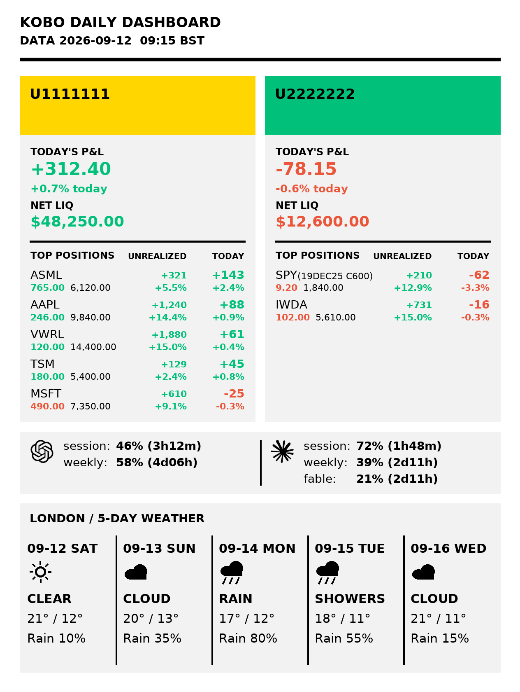

# kobo-slate

*A Kobo Libra Colour, minus the reading.*

I removed the useless book-reading feature from my e-reader. (Joke.)

The real reason: I wanted a notepad with an infinite canvas and free zoom, and
I could not find one — not on the Kobo, not anywhere that would run on a device
I already owned and could write on with a stylus. So I wrote one. And since the
device was sitting there doing nothing between notes, it also wakes on a timer
and shows a picture.

Both run on the stock firmware. Nothing soldered, nothing flashed, and Nickel is
one reboot away if you want your books back.

Open-sourced because it may as well be. Take whatever is useful.

<p align="center">
  
</p>

*What mine shows. The device did not compute any of that — it downloaded the
picture and drew it. The figures are invented for the screenshot.* There is a
clip of it running in [`assets/demo.mp4`](assets/demo.mp4).

## The notepad

The part I actually wanted:

- **Infinite canvas, free zoom.** One finger pans, two fingers pinch. No pages,
  no fixed size, no "new sheet" button.
- **The pen draws, fingers navigate.** The panel reports which is which, so
  there is no mode to switch and no heuristic to get wrong. The eraser end of
  the stylus rubs out whole strokes. A resting palm is ignored.
- **Append-only storage.** Strokes are appended, never rewritten, so a crash or
  a flat battery costs you the current stroke at worst.
- **Exports to SVG and PDF.** `tools/knp2svg.py` is the reference decoder, and
  `tools/fetch-notes.sh` pulls every notebook off the device in one go.

`notepad/README.md` has the file format and the gesture model.

## The dashboard, such as it is

**The device only displays pictures.** It has no idea what is in them. It does
not talk to any service, hold any credential, or run any renderer. Once every
few minutes it wakes up and does exactly this:

```
wake → Wi-Fi up → GET manifest.json → hash changed? → GET frame.raw.gz
     → write it to /dev/fb0 → Wi-Fi down → set the RTC alarm → suspend
```

Whatever produced that picture is your business. Mine is a script on a small
server that reads a few things I care about and renders a PNG; it is not in
this repository, and you do not need it or anything like it. A cron job with
ImageMagick would do. So would a Raspberry Pi. So would you, by hand, once.

That is also where the battery life comes from: the device is off almost
always, and when the hash has not changed it does not even redraw.

### What you have to serve

Any HTTP server on your LAN, holding two files:

| File | What it is |
|------|------------|
| `manifest.json` | `{"data_sha": "...", "frame": "frame.raw.gz", "generated": "...", "now_epoch": 1789238805, "next_wake_epoch": 1789240800, "stale": false}` |
| `frame.raw.gz` | gzipped raw framebuffer bytes — 1264 × 1680 × 4 (RGBA), 8 494 080 bytes before compression |

`data_sha` is any string that changes when the picture changes; the device
redraws only when it differs from the one it drew last. The wake interval is
derived from `next_wake_epoch − now_epoch`, so both come from the server's
clock and the device never needs its own to be right. `stale` only changes a
badge. `device/README.md` covers the transport, the retries and the failure
behaviour.

Converting a PNG to that frame is about five lines of Pillow: open, convert to
RGBA, check the size, `tobytes()`, gzip.

## What is where

| Directory | What it is |
|-----------|------------|
| `notepad/` | The notepad. C, talking to the framebuffer and the touch panel directly. |
| `device/` | The `/bin/sh` loop on the Kobo: Wi-Fi up, fetch, draw, Wi-Fi down, sleep. Reached from NickelMenu. |

Each has its own README with the real detail.

Everything installs into `/mnt/onboard/.adds/kobo-dash/` on the device, which
is what it was called before it had a name. Every one of those paths is a
`device/config.example` value, so put it wherever you like.

## Building the notepad

The device is ARM and a Mac has no cross toolchain, so `notepad/build.sh`
compiles on a remote host that has `arm-linux-gnueabihf-gcc` and a built
[FBInk](https://github.com/NiLuJe/FBInk):

```sh
BUILD_HOST=my-build-box sh notepad/build.sh
```

Everything that does not touch the framebuffer is tested on the host:

```sh
cd notepad && make test
```

## Before you run it on your own Kobo

Built against a Kobo Libra Colour on stock firmware, `mt8113t-ntx` platform,
1264×1680 panel. Other models differ in framebuffer geometry, Wi-Fi module and
power-supply node names. Those are all `device/config.example` values rather
than constants, but none of them have been tested anywhere except here.

The loop writes the framebuffer directly and suspends the device. The way out is
the power-key exit described in `device/README.md`, or a forced reset and a
reboot into Nickel. Keep `DEV=1` until you have watched it run and exit by hand
at least once — nothing here touches firmware, but a sleep loop you have not
tested is a sleep loop you cannot get out of.

## License

GPL-3.0-or-later, see [`LICENSE`](LICENSE). The notepad links FBInk, which is
GPLv3+, so the whole thing goes out under the same terms.
